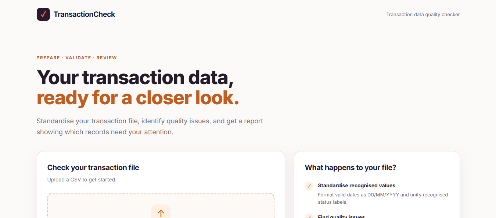
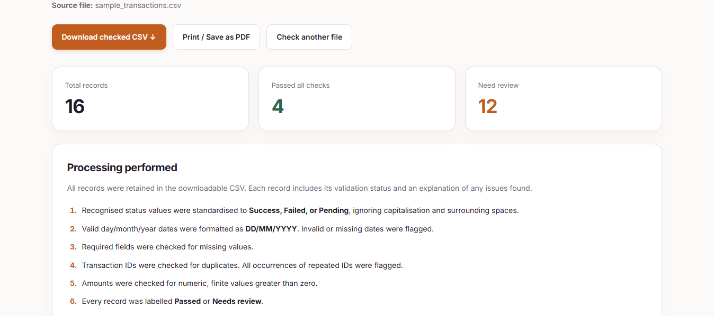

# Transaction Data Quality Checker

A Django and Python application that standardises transaction data, detects quality issues, and produces an actionable review report, while retaining every uploaded record.

## The problem

Transaction CSVs can contain missing information, repeated transaction IDs, inconsistent status labels, invalid amounts, and incorrectly formatted dates. Before using these files for analysis or reporting, someone must identify the problems and decide which values can be safely corrected.

Repeating these checks manually takes effort and makes it harder to apply the same rules consistently. Deleting questionable records can also remove useful information, while guessing replacement values can introduce errors.

## My solution

I built a web application that applies defined validation rules to an uploaded transaction CSV. It standardises recognised statuses and valid dates, flags unresolved issues, and explains which records require human review.

The application provides one downloadable CSV containing every record, a validation status, and any associated issues. A report page summarises the findings, explains the processing performed, and displays records needing attention. Users can print the report or save it as a PDF through their browser.

## How it improves the workflow

| Manual task | Application behaviour | Practical benefit |
|---|---|---|
| Inspect required fields for blanks | Checks missing values automatically | Reduces repetitive inspection |
| Find repeated transaction IDs | Flags every occurrence of a duplicate ID | Makes conflicts visible without choosing a record to discard |
| Reformat dates and status labels | Applies explicit standardisation rules | Produces more consistent values |
| Review each amount and date | Applies numeric and calendar-date validation | Identifies rule violations consistently |
| Write a quality summary | Generates counts and an issue report | Makes results easier to inspect and communicate |
| Track questionable records separately | Adds validation and issue columns to every record | Preserves context for follow-up review |

These are workflow benefits, not measured performance claims. I have not benchmarked time savings or evaluated the application on production transaction data.

## Features

- CSV upload with a 2 MB file-size limit.
- Required-column validation.
- Missing-value checks, including whitespace-only values.
- Duplicate transaction ID detection, including the first occurrence.
- Amount checks for numeric, finite values greater than zero.
- Date validation using a declared day/month/year convention.
- Standardisation of valid dates to `DD/MM/YYYY`.
- Standardisation of recognised statuses to `Success`, `Failed`, or `Pending`.
- Multiple issue descriptions for a single record.
- One CSV download containing all records, `validation_status`, and `issues`.
- Report with record totals, issue counts, processing notes, and flagged rows.
- Browser printing and Save as PDF.
- Downloadable synthetic sample data for trying the application.
- Responsive upload and report interfaces.

## Validation rules

| Column | Rule | Handling |
|---|---|---|
| `transaction_id` | Required and unique after trimming surrounding spaces for comparison | Missing IDs and all occurrences of repeated IDs are flagged |
| `amount` | Required, numeric, finite, and greater than zero | Blank values are marked missing; other violations are marked invalid |
| `transaction_date` | Required, a real date, and in day/month/year format | Valid dates are formatted as `DD/MM/YYYY`; other values are flagged |
| `status` | Required and included in the approved mapping | Recognised values are standardised; missing or unknown values are flagged |


## Technology stack

| Technology | Purpose |
|---|---|
| Python | Validation and processing logic |
| Django | Upload handling, routing, and report rendering |
| pandas | CSV reading, transformations, and record-level checks |
| NumPy | Finite-number validation |
| HTML and CSS | Responsive upload and report pages |
| JavaScript | File-selection feedback and submission state |

## How it works

1. The user uploads a CSV containing the required columns.
2. Django passes the uploaded file to a separate checking function.
3. The checker reads the values as text to preserve IDs and original entries.
4. It applies validation rules and standardises recognised dates and statuses.
5. Each record receives a validation status and any issue descriptions.
6. Django renders the report and embeds the generated CSV for download.

Transaction records are not written to an application database. Download results are embedded in the response page rather than stored in a database or retained for a later session. Upload handling may use temporary files depending on Django's configuration.

## Run locally

### Requirements

- Python 3 with a version compatible with the project's Django release.
- Git.

### Setup

## To install and run the project
1. Create a django environment 
2. clone the Repository
 ```bash
 git clone https://github.com/kausaratg/transaction-data-quality-checker
 ``` 
3  Enter into the directory
```bash
cd transaction quality checker
```
4.  Pull any recent change from main branch
   ```bash
 git pull origin main
```
5.  create a virtual env
  ```bash
python -m venv env
```
6. Activate the virtual env
```bash
env/Scripts/activate
```
7. Install dependencies
 ```bash
pip install -r requirements.txt
```
8. Make migration
```bash
python manage.py makemigration
```
9. Migrate the project
```bash
python manage.py migrate
```
10. Run local Server
```bash
python manage.py runserver
```

## Try the sample data

The included `sample_data/transactions.csv` contains **1,000 synthetic transactions** with deliberately introduced errors. It includes valid records, missing fields, duplicate IDs, invalid amounts, impossible dates, incorrect date formats, unknown statuses, and records containing multiple issues.

1. Select **Download sample CSV** on the upload page, or use the file in `sample_data`.
2. Upload the sample without editing it.
3. Inspect the report and the records needing review.
4. Download the checked CSV and inspect its validation columns.

Expected results under the documented rules:

| Result | Records |
|---|---:|
| Total | 1,000 |
| Passed | 640 |
| Needs review | 360 |

These are expected results for the supplied sample, not a claim of independent test coverage. Editing the sample or changing validation rules can change the totals.

## Design decisions

- **Retain all records:** questionable transactions may contain information needed for investigation.
- **Keep validation separate from Django views:** the checking function can be exercised independently of the interface.
- **Use an explicit date convention:** `01/02/2026` means 1 February; the application does not guess between day/month and month/day.
- **Flag every duplicate occurrence:** keeping the first record automatically would imply it is authoritative without evidence.
- **Separate missing and invalid values:** an empty amount receives a missing-value issue rather than an additional invalid-amount issue.
- **Avoid transaction database storage:** this version focuses on checking one uploaded file and returning its results.

## Limitations

- This is a personal project demonstrated with synthetic data, not a production financial validation system.
- The tool does not reconcile transactions against bank statements, payment-provider records, or another authoritative source.
- It runs after a user uploads a file; it does not automatically receive daily files or run scheduled jobs.
- Downloads are CSV files, so they do not contain cell colours. Highlighting appears on the report page.
- The report describes rules applied; it does not yet count individual standardisation changes or provide a complete before-and-after audit trail.


## Skills demonstrated

This project combines data preparation with application development: 
-defining quality rules
- validating structured data
- standardising known categories
- preserving unresolved records
- building reusable Python logic
- communicating results through a usable web interface.

## Home Page


## Report Page



